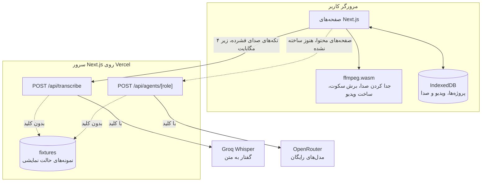

<div dir="rtl">

# ایران استودیو

**خام بده، آماده ببر.**

استودیوی تولید محتوا و ادیت ویدیو برای یوتیوب، فارسی و راست‌به‌چپ.

**سایت:** https://iran-studio.vercel.app

## ایران استودیو چیست و برای چه کسی است

جمله‌ی صفحه‌ی اصلی خود سایت این است:

> به سازنده‌های محتوای فارسی‌زبان که جلوی صفحه‌ی خالی یا پشت ادیت گیر می‌کنن کمک می‌کنیم از ایده و سناریو تا ویدیوی آماده‌ی یوتیوب و شورتس برسن؛ تا وقتشون صرف ساختن بشه، نه گیر کردن.

«خام» یعنی هم ایده‌ی خام، هم ویدیوی خام. کار از یکی از این دو شروع می‌شود:
- **از یک ایده:** هنوز چیزی ضبط نکرده‌ای. کار از ایده و سناریو شروع می‌شود.
- **از یک ویدیوی خام:** ویدیو را ضبط کرده‌ای. آپلودش می‌کنی و کار از ادیت شروع می‌شود.

هر پروژه هفت مرحله دارد: ایده‌پرداز، سناریونویس، نویسنده، ویراستار، ضبط، تدوینگر و آماده‌ی انتشار. خروجی آخر یک بسته‌ی انتشار است: ویدیو، عنوان، توضیحات، فصل‌ها، هشتگ‌ها و متن کاور.

پروژه‌ها و ویدیوها در مرورگر خود کاربر می‌مانند. ثبت‌نام، ورود به حساب و پایگاه داده نداریم.

## قابلیت‌ها و وضعیت امروز

این وضعیت‌ها از یک آزمون خودکار روی نسخه‌ی ساخته‌شده‌ی `main` آمده‌اند: کامیت `59a4cd1`، ۹ آبان ۱۴۰۵، بدون هیچ کلید API. آزمون کل مسیر را از صفحه‌ی اصلی تا دانلود بسته‌ی انتشار پیمود. جزئیات هر قدم و کار مانده‌ی هر نفر در [سناریوی دمو](docs/demo-scenario.md) آمده است.

| نشانه | یعنی |
| --- | --- |
| ✅ | امروز کار می‌کند. |
| ⚠️ | کار می‌کند، ولی با نمونه یا با یک راه میان‌بر. |
| ❌ | هنوز ساخته نشده. |

| قابلیت | وضعیت | توضیح |
| --- | --- | --- |
| صفحه‌ی اصلی و خرید اشتراک نمایشی | ✅ | خرید نمایشی است: پولی گرفته نمی‌شود و چیزی ذخیره نمی‌شود. |
| ساخت پروژه و شناسنامه‌ی کانال | ✅ | با نقطه‌ی شروع «از یک ایده» یا «از یک ویدیوی خام». |
| فهرست پروژه‌ها و نوار مراحل | ✅ | نوار هفت مرحله بالای همه‌ی صفحه‌های پروژه است و به ضبط، تدوینگر و آماده‌ی انتشار پیوند دارد. |
| ایده، سناریو، نوشتن و ویرایش با هوش مصنوعی | ❌ | اتصال به OpenRouter و دستیار ایده ([#48](https://github.com/elenaabbasabadi85-hash/IRAN-STUDIO/pull/48)) آماده‌اند. دستیار ایده در حالت نمایشی پنج کارت ایده‌ی نمونه برمی‌گرداند. ولی صفحه‌های این چهار مرحله و بقیه‌ی دستیارها هنوز ساخته نشده‌اند. |
| ضبط با تله‌پرامپتر | ⚠️ | دوربین، میکروفون و تله‌پرامپتر کار می‌کنند. متن تله‌پرامپتر هنوز از سناریو نمی‌آید و باید چسبانده شود. |
| آپلود ویدیوی خام | ✅ | MP4، M4V، WebM یا MOV. ویدیو فقط در همین مرورگر ذخیره می‌شود. |
| ترنسکریپت فارسی | ⚠️ | بدون کلید، ترنسکریپت نمونه با نشان «دمو» می‌آید و به صدای ویدیو ربطی ندارد. |
| حذف خودکار سکوت و ساخت ویدیو | ✅ | در خود مرورگر. ویدیوی ۴۰ ثانیه‌ای در حدود ۱۲ ثانیه ساخته شد. |
| شورتس، زیرنویس SRT و کاور | ❌ | هنوز ساخته نشده‌اند. زیرنویس SRT در درخواست [#46](https://github.com/elenaabbasabadi85-hash/IRAN-STUDIO/pull/46) است. |
| آماده‌ی انتشار و دانلود ZIP | ⚠️ | ZIP با ویدیو و متن انتشار دانلود می‌شود، ولی متن‌ها هنوز نمونه‌اند. |
| حالت بدون چهره | ⚠️ | صفحه‌ی ضبط هنوز این گزینه را ندارد. ویدیوی بدون چهره، مثلاً ضبط صفحه با صدای خودت، را می‌شود آپلود کرد. |

## نمای معماری



- **در مرورگر:**
  - **صفحه‌ها:** Next.js (App Router)، React و Tailwind CSS.
  - **ویدیو:** همه‌ی کار ویدیو با ffmpeg.wasm انجام می‌شود و ویدیو هیچ‌وقت به سرور نمی‌رود.
  - **ذخیره:** پروژه‌ها و فایل‌ها در IndexedDB، با Dexie.
  - **بسته‌ی انتشار:** فایل ZIP هم همین‌جا ساخته می‌شود، با client-zip.
- **روی سرور:** فقط دو مسیر API هست و هر دو کلید را فقط روی سرور می‌خوانند:
  - `POST /api/transcribe`: یک تکه‌ی صدای فشرده را با Whisper روی Groq به متن فارسی با زمان هر کلمه تبدیل می‌کند.
  - `POST /api/agents/[role]`: یک دستیار محتوا را با OpenRouter اجرا می‌کند. جواب با Zod سنجیده می‌شود. امروز هنوز هیچ صفحه‌ای این مسیر را صدا نمی‌زند.
- **قرارداد مشترک:** نوع‌های داده‌ای که هر سه بخش به کار می‌برند در [`src/core/types.ts`](src/core/types.ts) است.

| پوشه | چه چیزی | مسیر کاری |
| --- | --- | --- |
| `src/components`، `src/styles`، `src/storage`، `src/i18n` | اجزای رابط برند، رنگ‌ها و فونت‌ها، ذخیره در مرورگر، متن‌های فارسی | پلتفرم |
| `src/video` | ضبط، آپلود، ترنسکریپت، برش سکوت و موتور ffmpeg | ویدیو |
| `src/agents`، `prompts`، `fixtures` | دستیارهای محتوا، پرامپت‌ها و نمونه‌های حالت نمایشی | محتوا |
| `src/app` | صفحه‌ها و مسیرهای API، هر کدام مال مسیر کاری خودش | هر سه |
| `src/core` | قرارداد مشترک | تغییرش تأیید هر سه نفر را لازم دارد |

فهرست دقیق پوشه‌های هر مسیر در [AGENTS.md](AGENTS.md) است. دلیل تصمیم‌های اصلی در [یادداشت‌های تصمیم](docs/decisions/README.md) آمده است.

## اجرا روی رایانه

به Node.js نسخه‌ی 20.9 یا بالاتر نیاز داری. بررسی خودکار GitHub با Node.js 22 اجرا می‌شود.

```bash
git clone https://github.com/elenaabbasabadi85-hash/IRAN-STUDIO.git
cd IRAN-STUDIO
npm install
npm run dev
```

بعد نشانی http://localhost:3000 را در مرورگر باز کن. برای نسخه‌ی ساخته‌شده، `npm run build` و بعد `npm start` را بزن.

**بررسی‌ها:** همان بررسی‌هایی که GitHub روی هر درخواست ادغام اجرا می‌کند:

```bash
npm run lint
npx next typegen
npx tsc --noEmit
npm run build
```

**آزمون‌ها:**

```bash
node src/agents/extractJson.test.mjs
node src/video/cuts.test.mjs
node src/video/transcribe/merge.test.mjs
node "src/app/studio/[id]/publish/kit.test.mjs"
```

## حالت نمایشی بدون کلید

برنامه بدون هیچ کلید API هم کار می‌کند. هر جا سرویسی کلید لازم دارد و کلید نیست، فایل نمونه‌ای از پوشه‌ی `fixtures` جواب می‌دهد و صفحه یا جواب نشان می‌دهد که نمونه است.

| کلید | برای چه | بدون کلید |
| --- | --- | --- |
| `GROQ_API_KEY` | ترنسکریپت فارسی با Whisper روی Groq | ترنسکریپت نمونه با نشان «دمو» |
| `OPENROUTER_API_KEY` | دستیارهای محتوا | جواب نمونه با `demo: true` |
| `YOUTUBE_API_KEY` | در `.env.example` هست، ولی هنوز هیچ جای کد آن را نمی‌خواند. | — |

برای امتحان سرویس‌های واقعی، `.env.example` را با نام `.env.local` کپی کن و کلیدها را در آن بنویس. `.env.local` هیچ‌وقت کامیت نمی‌شود.

بقیه‌ی قسمت‌های نمایشی:
- **بسته‌ی انتشار:** تا وقتی نویسنده متن‌های انتشار را ننوشته، صفحه‌ی آماده‌ی انتشار یک نمونه با نشان «نمایشی» نشان می‌دهد.
- **خرید اشتراک:** نمایشی است و هیچ پرداختی انجام نمی‌شود.

پیش از گذاشتن `OPENROUTER_API_KEY` روی Vercel، مسیر دستیارها باید محدود شود: ایشوی [#53](https://github.com/elenaabbasabadi85-hash/IRAN-STUDIO/issues/53).

## هزینه‌ی کم

- **ویدیو روی سرور پردازش نمی‌شود.** همه‌ی کار ویدیو در مرورگر کاربر انجام می‌شود. سرور فقط تکه‌های صدای فشرده را می‌گیرد: MP3 مونو ۱۶ کیلوهرتز، هر تکه زیر ۴ مگابایت.
- **پایگاه داده نداریم.** پروژه‌ها و فایل‌ها در IndexedDB مرورگر کاربر می‌مانند.
- **مدل‌های رایگان:** همه‌ی دستیارهای محتوا مدل رایگان OpenRouter (`:free`) دارند، با یک مدل جایگزین رایگان از سازنده‌ی دیگر. اگر جواب خراب بود، فقط یک بار دوباره پرسیده می‌شود و بعد مدل جایگزین امتحان می‌شود.
- **ترنسکریپت در پروژه ذخیره می‌شود.** برش سکوت از همان ترنسکریپت ساخته می‌شود و زیرنویس هم از همان ساخته خواهد شد.
- **بدون کلید هیچ سرویس پولی‌ای صدا زده نمی‌شود.**

جزئیات در یادداشت‌های تصمیم [۱](docs/decisions/0001-video-in-the-browser.md)، [۲](docs/decisions/0002-projects-in-the-browser.md) و [۳](docs/decisions/0003-free-models-with-fallback.md) آمده است.

## کار گروهی سه‌نفره با GitHub

| نام | مسیر کاری | مسئولیت |
| --- | --- | --- |
| محبوبه | پلتفرم | ظاهر و اجزای رابط، ذخیره‌سازی، متن‌های فارسی رابط، صفحه‌ی اصلی و اشتراک، ساخت پروژه، آماده‌ی انتشار، مستندات و تنظیمات |
| النا | ویدیو | ضبط، آپلود، ترنسکریپت، برش سکوت و تدوین |
| علیرضا | محتوا | دستیارهای هوش مصنوعی، پرامپت‌ها، ابزارهای زبان فارسی، فایل‌های نمونه، ایده، سناریو، نوشتن و ترندها |

هر کس فقط فایل‌های مسیر خودش را تغییر می‌دهد. هر کار این مسیر را طی می‌کند:

1. **ایشو:**
   - با یکی از دو قالب فارسی «پیشنهاد قابلیت» یا «گزارش باگ».
   - با برچسب مسیر: `area:platform`، `area:video` یا `area:agents`.
   - در یکی از سه مایل‌استون: «دروازه ۱: اسکلت و ضبط»، «دروازه ۲: مسیر طلایی» و «تحویل: دمو و نسخه‌ی ۱».
2. **شاخه:** برای هر کار یک شاخه‌ی تازه از `main`.
3. **کامیت:** کوچک، به انگلیسی و به شیوه‌ی Conventional Commits.
4. **درخواست ادغام:** کوچک، با توضیح فارسی و خط `Closes #...`.
5. **بررسی خودکار:** GitHub Actions روی هر درخواست lint، بررسی نوع‌ها و build را اجرا می‌کند.
6. **بازبینی:** یک نفر دیگر از تیم کد را بررسی و تأیید می‌کند.
7. **ادغام:** با Squash and merge.

**قانون‌های شاخه‌ی `main` در GitHub:**
- **فقط با درخواست ادغام:** چیزی مستقیم به `main` فرستاده نمی‌شود.
- **تأیید و بررسی:** دست‌کم یک تأیید لازم است و بررسی خودکار `build` باید سبز باشد.
- **حفاظت تاریخچه:** force push و پاک کردن شاخه بسته است.

**دستیارهای هوش مصنوعی:** قوانین مشترکشان در [AGENTS.md](AGENTS.md) است: زبان، مسیرها و مالکیت پوشه‌ها، گیت، کلیدها، رابط کاربری و هزینه.

تا ۹ آبان ۱۴۰۵، ۲۳ درخواست ادغام شده است. روش کار قدم‌به‌قدم در [راهنمای همکاری](CONTRIBUTING.md) آمده است.

## مستندات

- [سناریوی دمو](docs/demo-scenario.md): اجرای پنج دقیقه‌ای جلوی داورها، با وضعیت هر قدم
- [یادداشت‌های تصمیم](docs/decisions/README.md): هر تصمیم مهم، دلیلش و گزینه‌های دیگر
- [راهنمای همکاری](CONTRIBUTING.md): ایشو، شاخه، کامیت، درخواست ادغام و بازبینی
- [AGENTS.md](AGENTS.md): قوانین تیم و دستیارهای هوش مصنوعی

</div>
