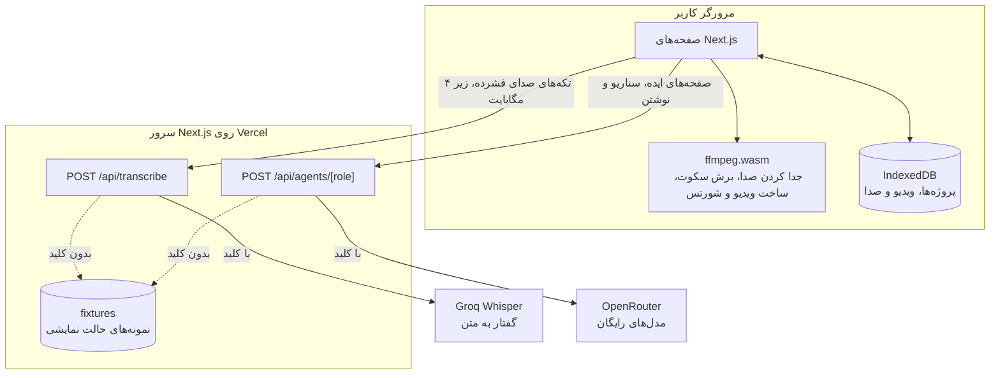

<div dir="rtl">

# ایران استودیو

**خام بده، آماده ببر.**

استودیوی تولید محتوا و ادیت ویدیو برای یوتیوب، فارسی و راست‌به‌چپ.

**سایت:** https://iran-studio.vercel.app

## ایران استودیو چیست و برای چه کسی است

جمله‌ی صفحه‌ی اصلی خود سایت این است:

> به سازنده‌های محتوای فارسی‌زبان که جلوی صفحه‌ی خالی یا پشت ادیت گیر می‌کنن کمک می‌کنیم از ایده و سناریو تا ویدیوی آماده‌ی یوتیوب و شورتس برسن؛ تا وقتشون صرف ساختن بشه، نه گیر کردن.

«خام» یعنی هم ایده‌ی خام، هم ویدیوی خام. کار از یکی از این دو شروع می‌شود:
- **از یک ایده:** هنوز چیزی ضبط نکرده‌ای. کار از ایده و سناریو شروع می‌شود.
- **از یک ویدیوی خام:** ویدیو را ضبط کرده‌ای. آپلودش می‌کنی و کار از ادیت شروع می‌شود.

هر پروژه هفت مرحله دارد: ایده‌پرداز، سناریونویس، نویسنده، ویراستار، ضبط، تدوینگر و آماده‌ی انتشار. خروجی آخر یک بسته‌ی انتشار است: ویدیو، شورتس، زیرنویس، تصویر کاور، و متن انتشار با عنوان، توضیحات، فصل‌ها، هشتگ‌ها و متن کاور.

پروژه‌ها و ویدیوها در مرورگر خود کاربر می‌مانند. ثبت‌نام، ورود به حساب و پایگاه داده نداریم.

## قابلیت‌ها و وضعیت امروز

این وضعیت‌ها از یک آزمون خودکار روی نسخه‌ی ساخته‌شده‌ی `main` آمده‌اند: کامیت `b21ae2b`، ۱۱ آبان ۱۴۰۵، بدون هیچ کلید API. آزمون کل مسیر را از صفحه‌ی اصلی تا دانلود بسته‌ی انتشار، روی رایانه و گوشی، پیمود. ردیف‌های نوار مراحل، سناریو، نوشتن و آماده‌ی انتشار بعد از ادغام پیوند سناریو (#76) و دستیار نویسنده (#79) دوباره روی کامیت `beb908a`، ۱۲ آبان ۱۴۰۵، امتحان شدند. بعد از ادغام صفحه‌ی نوشتن (#81)، کل مسیر روی کامیت `3135daf` به‌همراه پیوند مرحله‌ی نویسنده (#92)، ۱۴ آبان ۱۴۰۵، روی رایانه و گوشی دوباره پیموده شد؛ ردیف‌های نوار مراحل، متن‌های انتشار، ساخت ویدیو، شورتس و آماده‌ی انتشار از این امتحان آمده‌اند. جزئیات هر قدم و کار مانده‌ی هر نفر در [سناریوی دمو](docs/demo-scenario.md) آمده است.

| نشانه | یعنی |
| --- | --- |
| ✅ | امروز کار می‌کند. |
| ⚠️ | کار می‌کند، ولی با نمونه یا با یک راه میان‌بر. |
| ❌ | هنوز ساخته نشده. |

| قابلیت | وضعیت | توضیح |
| --- | --- | --- |
| صفحه‌ی اصلی و خرید اشتراک نمایشی | ✅ | خرید نمایشی است: پولی گرفته نمی‌شود و چیزی ذخیره نمی‌شود. |
| ساخت پروژه و شناسنامه‌ی کانال | ✅ | با نقطه‌ی شروع «از یک ایده» یا «از یک ویدیوی خام». |
| فهرست پروژه‌ها و نوار مراحل | ✅ | نوار هفت مرحله بالای همه‌ی صفحه‌های پروژه است و به ایده‌پرداز، سناریونویس، نویسنده، ضبط، تدوینگر و آماده‌ی انتشار پیوند دارد. فقط ویراستار هنوز صفحه ندارد. |
| ایده با هوش مصنوعی | ⚠️ | صفحه‌ی ایده ([#57](https://github.com/elenaabbasabadi85-hash/IRAN-STUDIO/pull/57)) کار می‌کند: پنج کارت ایده، انتخاب و ویرایش یکی، و تأیید آن که در پروژه ذخیره می‌شود. بدون کلید، کارت‌ها نمونه‌اند و نشان «نمایشی» دارند. از صفحه‌ی پروژه با «ایده بگیر» و از نوار مراحل باز می‌شود. |
| سناریو با هوش مصنوعی | ⚠️ | صفحه‌ی سناریو ([#70](https://github.com/elenaabbasabadi85-hash/IRAN-STUDIO/pull/70)) و دستیار سناریو ([#61](https://github.com/elenaabbasabadi85-hash/IRAN-STUDIO/pull/61)) کار می‌کنند: سه قلاب، هفت بخش و طول سناریو، انتخاب یک قلاب، ویرایش، و تأیید که در پروژه ذخیره می‌شود. بدون کلید، سناریو نمونه است و نشان «نمایشی» دارد. از صفحه‌ی پروژه با «سناریو بگیر» و از نوار مراحل باز می‌شود ([#76](https://github.com/elenaabbasabadi85-hash/IRAN-STUDIO/pull/76)). |
| متن‌های انتشار با هوش مصنوعی | ⚠️ | صفحه‌ی نوشتن ([#81](https://github.com/elenaabbasabadi85-hash/IRAN-STUDIO/pull/81)) و دستیار نویسنده ([#79](https://github.com/elenaabbasabadi85-hash/IRAN-STUDIO/pull/79)) کار می‌کنند: پنج عنوان، سه متن کاور، توضیحات و هشتگ‌ها، ویرایش، و تأیید که در پروژه ذخیره می‌شود و در آماده‌ی انتشار می‌آید. بدون کلید، متن‌ها نمونه‌اند و نشان «نمایشی» دارند. از صفحه‌ی پروژه با «متن‌های انتشار رو بنویس» و از نوار مراحل باز می‌شود. فقط برای ایده و سناریوی تأییدشده می‌نویسد، پس پروژه‌ی «از یک ویدیوی خام» هنوز متن انتشار ندارد. |
| ویرایش با هوش مصنوعی | ❌ | دستیار ویراستار و صفحه‌اش هنوز ساخته نشده‌اند. |
| ضبط با تله‌پرامپتر | ✅ | دوربین، میکروفون و تله‌پرامپتر کار می‌کنند. تله‌پرامپتر خودش سناریوی تأییدشده را نشان می‌دهد: قلاب انتخاب‌شده، بخش‌ها و دعوت به اقدام. |
| آپلود ویدیوی خام | ✅ | MP4، M4V، WebM یا MOV. ویدیو فقط در همین مرورگر ذخیره می‌شود. |
| ترنسکریپت فارسی | ⚠️ | بدون کلید، ترنسکریپت نمونه با نشان «دمو» می‌آید و به صدای ویدیو ربطی ندارد. |
| حذف خودکار سکوت و ساخت ویدیو | ✅ | در خود مرورگر. ویدیوی ۴۰ ثانیه‌ای امروز در حدود ۵۲ ثانیه ساخته شد. درخواست باز [#86](https://github.com/elenaabbasabadi85-hash/IRAN-STUDIO/pull/86) این زمان را به حدود ۱۳ ثانیه برمی‌گرداند. |
| شورتس، زیرنویس SRT و کاور | ⚠️ | هر سه کار می‌کنند و در خروجی‌های پروژه ذخیره می‌شوند: زیرنویس SRT از روی ترنسکریپت ([#46](https://github.com/elenaabbasabadi85-hash/IRAN-STUDIO/pull/46))، کاور از یک فریم با متن فارسی ([#66](https://github.com/elenaabbasabadi85-hash/IRAN-STUDIO/pull/66)) و شورتس ۹:۱۶ از ویدیوی کوتاه‌شده ([#68](https://github.com/elenaabbasabadi85-hash/IRAN-STUDIO/pull/68)). یک کلیپ ۲۳ ثانیه‌ای در حدود ۳۰ ثانیه ساخته شد. بدون کلید، زیرنویس و برش پیشنهادی شورتس از ترنسکریپت نمونه می‌آیند. |
| آماده‌ی انتشار و دانلود ZIP | ⚠️ | ZIP با ویدیو، شورتس، زیرنویس، کاور و متن انتشار دانلود می‌شود. متن‌ها همان متن‌های تأییدشده‌ی صفحه‌ی نوشتن‌اند. پروژه‌ای که متن تأییدشده ندارد، مثل هر پروژه‌ی «از یک ویدیوی خام»، نمونه‌ی دستیار نویسنده را با نشان «نمایشی» نشان می‌دهد. |
| حالت بدون چهره | ⚠️ | صفحه‌ی ضبط هنوز این گزینه را ندارد. ویدیوی بدون چهره، مثلاً ضبط صفحه با صدای خودت، را می‌شود آپلود کرد. |

## نمای معماری



- **در مرورگر:**
  - **صفحه‌ها:** Next.js (App Router)، React و Tailwind CSS.
  - **ویدیو:** همه‌ی کار ویدیو با ffmpeg.wasm انجام می‌شود و ویدیو هیچ‌وقت به سرور نمی‌رود. موتور ffmpeg هم از خود سایت (`/ffmpeg/`) بارگذاری می‌شود، نه از سرور دیگری.
  - **ذخیره:** پروژه‌ها و فایل‌ها در IndexedDB، با Dexie.
  - **بسته‌ی انتشار:** فایل ZIP هم همین‌جا ساخته می‌شود، با client-zip.
- **روی سرور:** فقط دو مسیر API هست و هر دو کلید را فقط روی سرور می‌خوانند:
  - `POST /api/transcribe`: یک تکه‌ی صدای فشرده را با Whisper روی Groq به متن فارسی با زمان هر کلمه تبدیل می‌کند.
  - `POST /api/agents/[role]`: یک دستیار محتوا را با OpenRouter اجرا می‌کند. جواب با Zod سنجیده می‌شود. صفحه‌های ایده، سناریو و نوشتن این مسیر را برای دستیارهای `idea`، `script` و `writer` صدا می‌زنند.
- **قرارداد مشترک:** نوع‌های داده‌ای که هر سه بخش به کار می‌برند در [`src/core/types.ts`](src/core/types.ts) است.

| پوشه | چه چیزی | مسیر کاری |
| --- | --- | --- |
| `src/components`، `src/styles`، `src/storage`، `src/i18n` | اجزای رابط برند، رنگ‌ها و فونت‌ها، ذخیره در مرورگر، متن‌های فارسی | پلتفرم |
| `src/video` | ضبط، آپلود، ترنسکریپت، برش سکوت، شورتس، زیرنویس، کاور و موتور ffmpeg | ویدیو |
| `src/agents`، `prompts`، `fixtures` | دستیارهای محتوا، پرامپت‌ها و نمونه‌های حالت نمایشی | محتوا |
| `src/app` | صفحه‌ها و مسیرهای API، هر کدام مال مسیر کاری خودش | هر سه |
| `src/core` | قرارداد مشترک | تغییرش تأیید هر سه نفر را لازم دارد |

فهرست دقیق پوشه‌های هر مسیر در [AGENTS.md](AGENTS.md) است. دلیل تصمیم‌های اصلی در [یادداشت‌های تصمیم](docs/decisions/README.md) آمده است.

## اجرا روی رایانه

به Node.js نسخه‌ی 20.9 یا بالاتر نیاز داری. بررسی خودکار GitHub با Node.js 22 اجرا می‌شود.

```bash
git clone https://github.com/elenaabbasabadi85-hash/IRAN-STUDIO.git
cd IRAN-STUDIO
npm install
npm run dev
```

بعد نشانی http://localhost:3000 را در مرورگر باز کن. برای نسخه‌ی ساخته‌شده، `npm run build` و بعد `npm start` را بزن.

**بررسی‌ها:** همان بررسی‌هایی که GitHub روی هر درخواست ادغام اجرا می‌کند:

```bash
npm run lint
npx next typegen
npx tsc --noEmit
npm run build
```

**آزمون‌ها:**

```bash
node src/agents/extractJson.test.mjs
node src/agents/scriptTiming.test.mjs
node src/video/cuts.test.mjs
node src/video/transcribe/merge.test.mjs
node src/video/subtitles/srt.test.mjs
node src/video/cover/cover.test.mjs
node src/video/shorts/suggest.test.mjs
node "src/app/studio/[id]/publish/kit.test.mjs"
```

## حالت نمایشی بدون کلید

برنامه بدون هیچ کلید API هم کار می‌کند. هر جا سرویسی کلید لازم دارد و کلید نیست، فایل نمونه‌ای از پوشه‌ی `fixtures` جواب می‌دهد و صفحه یا جواب نشان می‌دهد که نمونه است.

| کلید | برای چه | بدون کلید |
| --- | --- | --- |
| `GROQ_API_KEY` | ترنسکریپت فارسی با Whisper روی Groq | ترنسکریپت نمونه با نشان «دمو» |
| `OPENROUTER_API_KEY` | دستیارهای محتوا | جواب نمونه با `demo: true` |
| `YOUTUBE_API_KEY` | در `.env.example` هست، ولی هنوز هیچ جای کد آن را نمی‌خواند. | — |

برای امتحان سرویس‌های واقعی، `.env.example` را با نام `.env.local` کپی کن و کلیدها را در آن بنویس. `.env.local` هیچ‌وقت کامیت نمی‌شود.

بقیه‌ی قسمت‌های نمایشی:
- **بسته‌ی انتشار:** تا وقتی متن‌های انتشار در پروژه ذخیره نشده‌اند، صفحه‌ی آماده‌ی انتشار نمونه‌ی دستیار نویسنده (`fixtures/writer.json`) را با نشان «نمایشی» نشان می‌دهد.
- **خرید اشتراک:** نمایشی است و هیچ پرداختی انجام نمی‌شود.

پیش از گذاشتن `OPENROUTER_API_KEY` روی Vercel، مسیر دستیارها باید محدود شود: ایشوی [#53](https://github.com/elenaabbasabadi85-hash/IRAN-STUDIO/issues/53).

## هزینه‌ی کم

- **ویدیو روی سرور پردازش نمی‌شود.** همه‌ی کار ویدیو در مرورگر کاربر انجام می‌شود. سرور فقط تکه‌های صدای فشرده را می‌گیرد: MP3 مونو ۱۶ کیلوهرتز، هر تکه زیر ۴ مگابایت.
- **پایگاه داده نداریم.** پروژه‌ها و فایل‌ها در IndexedDB مرورگر کاربر می‌مانند.
- **مدل‌های رایگان:** همه‌ی دستیارهای محتوا مدل رایگان OpenRouter (`:free`) دارند، با یک مدل جایگزین رایگان از سازنده‌ی دیگر. اگر جواب خراب بود، فقط یک بار دوباره پرسیده می‌شود و بعد مدل جایگزین امتحان می‌شود.
- **ترنسکریپت در پروژه ذخیره می‌شود.** برش سکوت، زیرنویس و برش‌های پیشنهادی شورتس از همان ترنسکریپت ساخته می‌شوند.
- **بدون کلید هیچ سرویس پولی‌ای صدا زده نمی‌شود.**

جزئیات در یادداشت‌های تصمیم [۱](docs/decisions/0001-video-in-the-browser.md)، [۲](docs/decisions/0002-projects-in-the-browser.md) و [۳](docs/decisions/0003-free-models-with-fallback.md) آمده است.

## کار گروهی سه‌نفره با GitHub

| نام | مسیر کاری | مسئولیت |
| --- | --- | --- |
| محبوبه | پلتفرم | ظاهر و اجزای رابط، ذخیره‌سازی، متن‌های فارسی رابط، صفحه‌ی اصلی و اشتراک، ساخت پروژه، آماده‌ی انتشار، مستندات و تنظیمات |
| النا | ویدیو | ضبط، آپلود، ترنسکریپت، برش سکوت، تدوین، شورتس، زیرنویس و کاور |
| علیرضا | محتوا | دستیارهای هوش مصنوعی، پرامپت‌ها، ابزارهای زبان فارسی، فایل‌های نمونه، ایده، سناریو، نوشتن و ترندها |

هر کس فقط فایل‌های مسیر خودش را تغییر می‌دهد. هر کار این مسیر را طی می‌کند:

1. **ایشو:**
   - با یکی از دو قالب فارسی «پیشنهاد قابلیت» یا «گزارش باگ».
   - با برچسب مسیر: `area:platform`، `area:video` یا `area:agents`.
   - در یکی از سه مایل‌استون: «دروازه ۱: اسکلت و ضبط»، «دروازه ۲: مسیر طلایی» و «تحویل: دمو و نسخه‌ی ۱».
2. **شاخه:** برای هر کار یک شاخه‌ی تازه از `main`.
3. **کامیت:** کوچک، به انگلیسی و به شیوه‌ی Conventional Commits.
4. **درخواست ادغام:** کوچک، با توضیح فارسی و خط `Closes #...`.
5. **بررسی خودکار:** GitHub Actions روی هر درخواست lint، بررسی نوع‌ها و build را اجرا می‌کند.
6. **بازبینی:** یک نفر دیگر از تیم کد را بررسی و تأیید می‌کند.
7. **ادغام:** با Squash and merge.

**قانون‌های شاخه‌ی `main` در GitHub:**
- **فقط با درخواست ادغام:** چیزی مستقیم به `main` فرستاده نمی‌شود.
- **تأیید و بررسی:** دست‌کم یک تأیید لازم است و بررسی خودکار `build` باید سبز باشد.
- **حفاظت تاریخچه:** force push و پاک کردن شاخه بسته است.

**دستیارهای هوش مصنوعی:** قوانین مشترکشان در [AGENTS.md](AGENTS.md) است: زبان، مسیرها و مالکیت پوشه‌ها، گیت، کلیدها، رابط کاربری و هزینه.

تا ۱۱ آبان ۱۴۰۵، ۳۵ درخواست ادغام شده است. روش کار قدم‌به‌قدم در [راهنمای همکاری](CONTRIBUTING.md) آمده است.

## مستندات

- [سناریوی دمو](docs/demo-scenario.md): اجرای پنج دقیقه‌ای جلوی داورها، با وضعیت هر قدم
- [یادداشت‌های تصمیم](docs/decisions/README.md): هر تصمیم مهم، دلیلش و گزینه‌های دیگر
- [راهنمای همکاری](CONTRIBUTING.md): ایشو، شاخه، کامیت، درخواست ادغام و بازبینی
- [AGENTS.md](AGENTS.md): قوانین تیم و دستیارهای هوش مصنوعی

</div>
